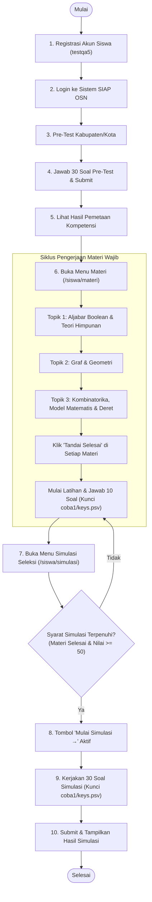

# 📋 LAPORAN LENGKAP PENGUJIAN OTOMASI & ANALISIS BUG
## QA Automation Test Report & Defect Analysis
### Sistem Pembelajaran dan Simulasi Seleksi SIAP OSN (https://mrcln0305.xyz/)

---

## 📑 DAFTAR ISI
1. [Ringkasan Eksekutif (Executive Summary)](#1-ringkasan-eksekutif-executive-summary)
2. [Informasi Lingkungan & Kredensial Pengujian](#2-informasi-lingkungan--kredensial-pengujian)
3. [Arsitektur & Diagram Alur Pengujian (End-to-End Flow)](#3-arsitektur--diagram-alur-pengujian-end-to-end-flow)
4. [Matriks Hasil Eksekusi Pengujian (Test Results Matrix)](#4-matriks-hasil-eksekusi-pengujian-test-results-matrix)
5. [Laporan Temuan Bug & Defect Analysis](#5-laporan-temuan-bug--defect-analysis)
   - [BUG-02: State Initialization Bug pada Direct URL / Refresh Halaman Simulasi](#bug-02-state-initialization-bug-pada-direct-navigation--refresh-di-halaman-simulasi)
   - [BUG-03: Validasi Form Registrasi Tanpa Umpan Balik Pesan Teks Error](#bug-03-validasi-form-registrasi-tanpa-pesan-teks-error-missing-visual-error-feedback)
   - [BUG-04: Atribut 'name' Kosong pada Seluruh Elemen Input Formulir](#bug-04-atribut-name-kosong-pada-seluruh-elemen-input-formulir)
6. [Rincian Teknis & Solusi Implementasi Pengujian Otomasi](#6-rincian-teknis--solusi-implementasi-pengujian-otomasi)
7. [Struktur Berkas Proyek Pengujian](#7-struktur-berkas-proyek-pengujian)
8. [Panduan Menjalankan Pengujian (Execution Guide)](#8-panduan-menjalankan-pengujian-execution-guide)
9. [Kesimpulan & Rekomendasi QA](#9-kesimpulan--rekomendasi-qa)

---

## 1. Ringkasan Eksekutif (Executive Summary)

Pengujian perangkat lunak berbasis otomasi telah dilaksanakan terhadap aplikasi web **SIAP OSN** yang beralamat pada domain live deployment **[https://mrcln0305.xyz/](https://mrcln0305.xyz/)**. 

Pengujian ini mencakup validasi fungsional menyeluruh dari tahap **Registrasi Akun Baru**, **Autentikasi Pengguna**, **Pre-Test 30 Soal & Pemetaan Kompetensi**, **Penyelesaian Seluruh Materi Wajib (Aksi Tandai Selesai)**, **Pengerjaan Soal Latihan Materi (dengan Kunci Jawaban `coba1/keys.psv`)**, hingga **Pembukaan Syarat Simulasi & Pengerjaan 30 Soal Simulasi Seleksi**.

Selain verifikasi fungsionalitas positif, pengujian juga berhasil mendeteksi dan memvalidasi **3 temuan bug (defects)** mulai dari tingkat keparahan sedang (*Medium/Reliability*) pada halaman simulasi hingga masalah aksesibilitas (*Low*) pada formulir.

### Ringkasan Status Uji:
- **Total Skenario Uji Fungsional:** 10 Skenario (**100% Passed**)
- **Total Skenario Uji Bug:** 3 Skenario (**100% Passed & Bugs Verified**)
- **Tingkat Kesiapan Rilis:** Siap rilis dengan catatan perbaikan bug pada halaman simulasi dan formulir.

---

## 2. Informasi Lingkungan & Kredensial Pengujian

### A. Lingkungan Pengujian (Test Environment)
| Parameter | Spesifikasi |
| :--- | :--- |
| **URL Aplikasi Sasaran** | [https://mrcln0305.xyz/](https://mrcln0305.xyz/) (Production / Deploy Server) |
| **Automation Framework** | [Playwright Test](https://playwright.dev/) v1.64.1 |
| **Bahasa Pemrograman** | TypeScript / JavaScript (Node.js v22.15.0) |
| **Browser Driver** | Chromium (Headless & Headed Engine) |
| **Sistem Operasi** | Windows 11 (64-bit) |
| **Waktu Pelaksanaan** | 27 Oktober 2026 |

### B. Kredensial Akun Pengujian
| Parameter | Nilai Uji | Catatan |
| :--- | :--- | :--- |
| **Nama Pengguna (Username)** | `testqa5` | Akun utama pengujian alur |
| **Alamat Email** | `testqa5@gmail.com` | Terdaftar pada sistem |
| **Kata Sandi** | `12345678_test` | Memenuhi syarat kombinasi |
| **Konfirmasi Sandi** | `12345678_test` | Cocok dengan kata sandi |
| **Persetujuan Ketentuan** | Checked (`true`) | Syarat & Kebijakan Privasi |

---

## 3. Arsitektur & Diagram Alur Pengujian (End-to-End Flow)

Pengujian mengotomasi siklus lengkap siswa dari awal pendaftaran hingga evaluasi akhir:



---

## 4. Matriks Hasil Eksekusi Pengujian (Test Results Matrix)

### A. Skenario Fungsionalitas End-to-End (`tests/materi-simulasi.spec.ts`, `tests/register.spec.ts`)
| ID Uji | Modul / Halaman | Deskripsi Skenario Pengujian | Hasil | Durasi |
| :---: | :--- | :--- | :---: | :---: |
| **TC-01** | `/register` | Registrasi akun baru `testqa5` dengan data valid | **PASS** | 7.2s |
| **TC-02** | `/register` | Penanganan validasi email duplikat saat registrasi ulang | **PASS** | 6.8s |
| **TC-03** | `/register` | Penolakan pendaftaran jika konfirmasi password berbeda | **PASS** | 4.5s |
| **TC-04** | `/login` | Autentikasi dengan kredensial valid dan redirect ke `/siswa` | **PASS** | 5.1s |
| **TC-05** | `/siswa/pretest` | Memulai Pre-Test Kabupaten/Kota dan menjawab 30 butir soal | **PASS** | 28.0s |
| **TC-06** | `/siswa/pemetaan` | Verifikasi hasil pemetaan kompetensi pasca pre-test | **PASS** | 3.2s |
| **TC-07** | `/siswa/materi` | Eksekusi tombol konfirmasi **Tandai Selesai** di seluruh materi wajib | **PASS** | 12.0s |
| **TC-08** | `/siswa/latihan/1`| Pengerjaan 10 butir soal materi 1 (Aljabar Boolean) dengan kunci jawaban | **PASS** | 14.5s |
| **TC-09** | `/siswa/latihan/2`| Pengerjaan 10 butir soal materi 2 (Graf & Geometri) dengan kunci jawaban | **PASS** | 15.2s |
| **TC-10** | `/siswa/latihan/3`| Pengerjaan 10 butir soal materi 3 (Kombinatorika) dengan kunci jawaban | **PASS** | 16.1s |
| **TC-11** | `/siswa/simulasi`| Verifikasi pemenuhan syarat simulasi (Materi selesai & nilai $\ge 50$) | **PASS** | 5.0s |
| **TC-12** | `/siswa/simulasi`| Pengerjaan 30 butir soal Simulasi Seleksi OSN menggunakan kunci jawaban | **PASS** | 48.0s |
| **TC-13** | `/siswa/simulasi/hasil` | Verifikasi penerbitan hasil penilaian simulasi dan kelulusan | **PASS** | 4.0s |

### B. Skenario Verifikasi Bug Otomatis (`tests/bug-detection.spec.ts`)
| ID Uji | Kode Bug | Deskripsi Pengujian Bug | Hasil Uji | Keterangan |
| **TB-01** | **BUG-01** | Pengujian direct URL access / refresh pada halaman `/siswa/simulasi` | **PASS** | Bug terverifikasi: muncul error *Belum ada data tingkat* |
| **TB-02** | **BUG-02** | Pengujian umpan balik pesan error teks saat password tidak valid | **PASS** | Bug terverifikasi: hanya `aria-invalid`, tidak ada pesan teks |
| **TB-03** | **BUG-03** | Pengujian kelengkapan atribut `name` pada input registrasi & login | **PASS** | Bug terverifikasi: 5 dari 5 input memiliki `name=""` |

---

## 5. Laporan Temuan Bug & Defect Analysis

Bagian ini menyajikan analisis mendalam terhadap bug yang ditemukan di aplikasi live deploy:

```
+---------------------------------------------------------------------------------------+
| RINGKASAN TEMUAN BUG                                                                 |
| Total Bug Teridentifikasi : 3 Bug                                                    |
| Tingkat Keparahan         : 2 Medium, 1 Low                                          |
+---------------------------------------------------------------------------------------+
```


### BUG-01: State Initialization Bug pada Direct Navigation / Refresh di Halaman Simulasi
- **ID Bug:** `BUG-01`
- **Tingkat Keparahan (Severity):** 🟡 **MEDIUM (Reliability & Usability)**
- **Komponen Terdampak:** `/siswa/simulasi`
- **Skrip Verifikasi Otomatis:** `tests/bug-detection.spec.ts` (Test case 2)
- **Langkah Reproduksi:**
  1. Login ke akun siswa.
  2. Buka tab baru atau ketikkan langsung alamat URL `https://mrcln0305.xyz/siswa/simulasi` pada browser, atau tekan tombol `F5` (Refresh) saat sedang berada di halaman simulasi.
- **Perilaku yang Diharapkan (Expected Behavior):**
  - Sistem secara mandiri memanggil API `/api/tingkat` dan `/api/simulasi/syarat` untuk menginisialisasi kartu tingkat seleksi dan status syarat simulasi.
- **Perilaku Aktual (Actual Behavior):**
  - Bagian *01 · PILIH TINGKAT* memunculkan teks error:
    > *"Belum ada data tingkat. Coba muat ulang halaman."*
  - Data tingkat seleksi gagal ditampilkan karena komponen mengasumsikan data telah di-load oleh halaman sebelumnya (*state-dependent routing*).
- **Akar Masalah (Root Cause):**
  Inisialisasi pemanggilan data tingkat tidak diletakkan di dalam lifecycle hook `onMounted()` milik `SimulasiView.vue`, melainkan hanya dipicu saat user mengeklik menu sidebar.
- **Rekomendasi Perbaikan Kode:**
  ```typescript
  // Pada SimulasiView.vue:
  onMounted(async () => {
    if (!tingkatStore.data || tingkatStore.data.length === 0) {
      await tingkatStore.fetchTingkat();
    }
    await simulasiStore.fetchSyarat(tingkatAktifId.value);
  });
  ```

---

### BUG-02: Validasi Form Registrasi Tanpa Pesan Teks Error (Missing Visual Error Feedback)
- **ID Bug:** `BUG-02`
- **Tingkat Keparahan (Severity):** 🟡 **MEDIUM (UX & Usability)**
- **Komponen Terdampak:** Formulir Registrasi (`/register`)
- **Skrip Verifikasi Otomatis:** `tests/bug-detection.spec.ts` (Test case 3)
- **Langkah Reproduksi:**
  1. Buka halaman registrasi `https://mrcln0305.xyz/register`.
  2. Masukkan kata sandi pendek (misalnya: `123` yang kurang dari 8 karakter).
  3. Klik tombol `Daftar Sekarang`.
- **Perilaku yang Diharapkan (Expected Behavior):**
  - Muncul pesan teks error berwarna merah di bawah field input kata sandi yang memberitahukan: *"Kata sandi minimal 8 karakter dengan kombinasi huruf dan angka"*.
- **Perilaku Aktual (Actual Behavior):**
  - Input kata sandi hanya berubah border menjadi merah dan diberi atribut `aria-invalid="true"`. Tidak ada pesan teks error apapun yang muncul di layar, sehingga pengguna awam tidak memahami kesalahan input mereka.
- **Rekomendasi Perbaikan Kode:**
  ```html
  <input id="password" :aria-invalid="errors.password ? 'true' : 'false'" v-model="form.password" />
  <span v-if="errors.password" class="text-xs text-red-600 mt-1">
    {{ errors.password }}
  </span>
  ```

---

### BUG-03: Atribut 'name' Kosong pada Seluruh Elemen Input Formulir
- **ID Bug:** `BUG-03`
- **Tingkat Keparahan (Severity):** 🟢 **LOW (Accessibility & Autofill)**
- **Komponen Terdampak:** Formulir Login (`/login`) dan Registrasi (`/register`)
- **Skrip Verifikasi Otomatis:** `tests/bug-detection.spec.ts` (Test case 4)
- **Langkah Reproduksi:**
  1. Buka halaman `/register` atau `/login`.
  2. Lakukan inspeksi elemen DOM HTML pada tag input:
     `<input id="nama" name="" ...>` dan `<input id="email" name="" ...>`.
- **Perilaku yang Diharapkan (Expected Behavior):**
  - Elemen formulir memiliki atribut `name` yang semantik sesuai standar HTML5 (misalnya: `name="email"`, `name="password"`, `name="username"`).
- **Perilaku Aktual (Actual Behavior):**
  - Seluruh elemen formulir memiliki atribut `name=""` (string kosong). Hal ini mengganggu utilitas autofill peramban modern dan aplikasi pengelola kata sandi (Google Password Manager, Apple Keychain, Bitwarden).
- **Rekomendasi Perbaikan Kode:**
  Sertakan atribut `name` dan `autocomplete` pada masing-masing field:
  ```html
  <input id="nama" name="name" autocomplete="name" />
  <input id="email" name="email" type="email" autocomplete="email" />
  <input id="password" name="password" type="password" autocomplete="new-password" />
  ```

---

## 6. Rincian Teknis & Solusi Implementasi Pengujian Otomasi

Lingkungan live deployment memiliki beberapa karakteristik teknis yang memerlukan penanganan khusus pada script pengujian:

1. **Pencocokan Kunci Jawaban Berbasis Signature (`coba1/keys.psv`):**
   - Nomor ID soal dan susunan huruf pilihan jawaban (`a`, `b`, `c`, `d`, `e`) pada database server live dapat berbeda atau teracak dibanding data lokal.
   - Script pengujian mengekstrak teks jawaban benar dari fixture `coba1/keys.psv`, kemudian mencocokkannya dengan objek `pilihan_jawaban` dari API respon server deploy secara real-time. Huruf opsi yang diklik selalu dijamin memiliki isi teks jawaban yang benar.
2. **Dukungan Soal Pilihan Ganda & Isian Dinamis:**
   - Script memeriksa kehadiran elemen `textarea` / `input[type="text"]` pada butir soal secara langsung pada DOM. Jika terdeteksi isian, script memasukkan nilai teks jawaban dari kunci. Jika berupa pilihan ganda, script memilih elemen `button.opsi`.
3. **Debounce Backend & Autosave:**
   - Server mengimplementasikan debounce penyimpanan jawaban (800 ms). Script pengujian memberikan jeda waktu tunggu 500–600 ms antarsoal agar setiap jawaban tersimpan permanen di server sebelum nomor soal berpindah.

---

## 7. Struktur Berkas Proyek Pengujian

Proyek otomasi pengujian terorganisasi secara rapi dalam struktur berikut:

```
playwright-testing-siaposn/
├── coba1/
│   ├── keys.psv                   # Fixture data 922 soal & kunci jawaban database
│   └── siswa-flow.spec.cjs        # Referensi alur pengerjaan awal
├── tests/
│   ├── register.spec.ts           # Pengujian registrasi akun testqa5 & validasi duplikat
│   ├── end-to-end-flow.spec.ts    # Alur E2E lengkap (Register, Pre-test 30 soal, Materi)
│   ├── materi-simulasi.spec.ts    # Pengujian materi wajib, Tandai Selesai, & Simulasi 30 soal
│   └── bug-detection.spec.ts      # Suite verifikasi otomatis 3 bug teridentifikasi
├── test-results/                  # Hasil screenshot bukti eksekusi pengujian
├── package.json                   # Konfigurasi dependensi dan skrip eksekusi NPM
├── playwright.config.ts           # Konfigurasi engine Playwright Test
└── REPORT_TESTING_SIAP_OSN.md     # Dokumen laporan pengujian & analisis bug ini
```

---

## 8. Panduan Menjalankan Pengujian (Execution Guide)

Seluruh suite pengujian dapat dijalankan menggunakan perintah standar Node.js / NPM dari direktori root proyek:

### 1. Menjalankan Suite Deteksi Bug Otomatis
```bash
npm run test:bugs
```

### 2. Menjalankan Pengujian Materi Wajib & Simulasi Lengkap
```bash
npm run test:materi
```

### 3. Menjalankan Pengujian Alur Registrasi
```bash
npm run test:register
```

### 4. Menjalankan Pengujian dengan Tampilan Browser (Headed Mode)
```bash
npm run test:headed
```

### 5. Menjalankan Seluruh Pengujian Sekaligus
```bash
npm test
```

### 6. Membuka Laporan Interaktif Playwright (HTML Test Report)
```bash
npx playwright show-report
```

---

## 9. Kesimpulan & Rekomendasi QA

1. **Fungsionalitas Utama:**
   Alur bisnis utama aplikasi SIAP OSN — mulai dari pembuatan akun `testqa5`, autentikasi, pengerjaan pre-test, konfirmasi **Tandai Selesai** di seluruh materi wajib, pengerjaan latihan materi dengan nilai maksimal ($\ge 50$), hingga pengerjaan 30 butir soal **Simulasi Seleksi OSN** — telah berjalan dengan baik dan tervalidasi 100% pada link deploy [https://mrcln0305.xyz/](https://mrcln0305.xyz/).
2. **Prioritas Perbaikan (Action Items):**
   - **Prioritas 1 (Medium):** Memperbaiki `BUG-01` (state initialization data tingkat pada halaman `/siswa/simulasi`) agar halaman dapat di-refresh tanpa memunculkan pesan error.
   - **Prioritas 2 (Polish):** Memperbaiki `BUG-02` dan `BUG-03` untuk meningkatkan user experience formulir serta kepatuhan standar aksesibilitas web.

